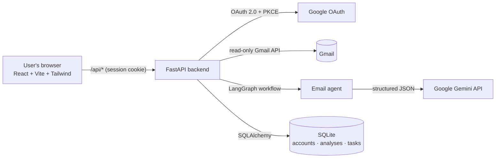
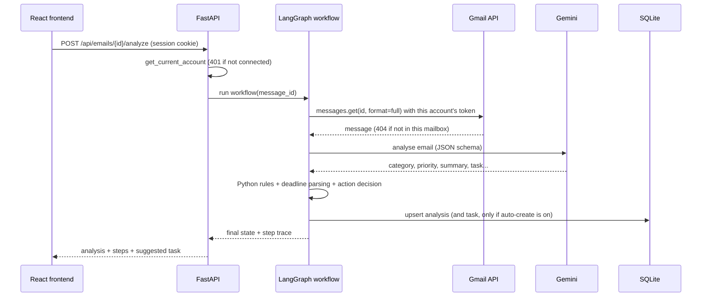
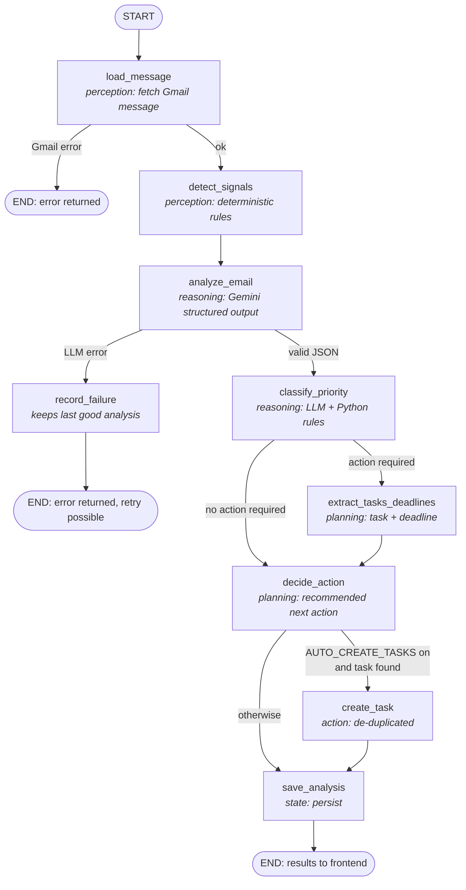

# Smart Email Management Using Agentic AI

A web application that connects to a **real Gmail account** (read-only, through Google OAuth 2.0),
and uses an **AI agent built with LangGraph and Google Gemini** to do the following for each email:

- classify it
- detect its priority and explain why
- summarise it
- extract tasks and deadlines
- recommend the next action
- draft reply suggestions

Tasks are saved in SQLite and managed from a React dashboard.

> **Status, stated honestly.** The code, the 63 automated tests (which use mocked Gmail and Gemini)
> and a browser walkthrough of every page (using fake Gmail data) were run during development. A
> live run against a real Gmail account and the real Gemini API needs your own Google Cloud
> project and API key, so it has **not** been run as part of building this repository. Follow
> [section 18](#18-connecting-a-real-gmail-account) and the
> [manual integration test](#manual-integration-test-real-gmail) to verify it yourself. The app
> runs in Google's **Testing** mode, which is fine for a college project but is **not**
> production-ready (see [section 21](#21-security-and-privacy-considerations)).

---

## Contents

1. [Project overview](#1-project-overview)
2. [Problem statement](#2-problem-statement)
3. [Objectives](#3-objectives)
4. [Scope](#4-scope)
5. [Features](#5-features)
6. [System architecture](#6-system-architecture)
7. [LangGraph workflow](#7-langgraph-workflow)
8. [Technology stack](#8-technology-stack)
9. [Gmail API setup](#9-gmail-api-setup)
10. [Google Cloud Console OAuth configuration](#10-google-cloud-console-oauth-configuration)
11. [OAuth redirect URI configuration](#11-oauth-redirect-uri-configuration)
12. [Gemini API key configuration](#12-gemini-api-key-configuration)
13. [Python environment setup (Windows step by step)](#13-python-environment-setup-windows-step-by-step)
14. [Frontend installation](#14-frontend-installation)
15. [Backend startup](#15-backend-startup)
16. [Database initialisation](#16-database-initialisation)
17. [Running automated tests](#17-running-automated-tests)
18. [Connecting a real Gmail account](#18-connecting-a-real-gmail-account)
19. [Using the application](#19-using-the-application)
20. [Troubleshooting](#20-troubleshooting)
21. [Security and privacy considerations](#21-security-and-privacy-considerations)
22. [Known limitations](#22-known-limitations)
23. [Future enhancements](#23-future-enhancements)
24. [Viva questions and answers](#24-viva-questions-and-answers)

Appendices: [API reference](#appendix-a-api-reference) · [Project structure](#appendix-b-project-structure) · [Configuration reference](#appendix-c-configuration-reference)

---

## 1. Project overview

Students and professionals receive many emails a day: assignment deadlines, meeting requests,
bills, newsletters and promotions are all mixed together. **Smart Email Agent** reads your Gmail
inbox (with your permission) and turns each email you choose into structured, actionable
information:

| You get | Example |
|---|---|
| Category | Academic |
| Priority + reason | High: "The report has a firm deadline this week." |
| Summary | "The project report must be submitted by Friday at 5 PM." |
| Action / response required | Action: Yes · Response: No |
| Task + deadline | "Submit the project report", due "Friday at 5 PM" |
| Recommended action | Create a task / reminder |
| Reply suggestion | An editable draft you can copy into Gmail |

The app is **read-only towards Gmail**. It never sends, deletes, archives or modifies email.

## 2. Problem statement

Manually checking a busy inbox is slow and error-prone: important deadlines get buried under
promotions, and it is easy to forget which emails need a reply. Rule-based mail filters can
sort by sender or keyword, but they cannot *understand* what an email asks you to do. The project
explores how an **agentic AI system** can combine:

- a large language model, which understands natural language, and
- deterministic program logic and tools, which are reliable, auditable and safe,

to reduce the effort of managing email while keeping the user in control.

## 3. Objectives

1. Connect securely to a real Gmail account using OAuth 2.0 with the minimum permission (`gmail.readonly`).
2. Fetch and display real emails with pagination, search and filters.
3. Classify emails into Academic, Work, Personal, Meeting, Finance, Promotion or Other.
4. Detect priority (High / Medium / Low) with an explanation, combining the LLM with Python rules.
5. Summarise emails without inventing facts.
6. Extract tasks and deadlines, keeping the original deadline wording.
7. Recommend the next action and identify emails that need a reply.
8. Create, list and complete tasks, without duplicates, persisted in SQLite.
9. Generate editable, AI-labelled reply suggestions (never sent automatically).
10. Coordinate the workflow with LangGraph using state, conditional routing and tools.

## 4. Scope

**In scope:** a single-user local web app; read-only Gmail; one LangGraph workflow; Gemini for
language understanding; SQLite storage; task management; reply suggestions.

**Out of scope (deliberately):**

- sending, deleting or archiving email
- Google Calendar integration
- multiple collaborating agents
- vector databases
- model training
- microservices or Kubernetes
- production deployment

## 5. Features

| # | Feature | Where |
|---|---|---|
| A | **Email classification** into 7 categories, shown in the inbox and details page, filterable | Inbox, Email Details |
| B | **Priority detection** (High/Medium/Low) with an explanation. Rules stop promotions from being marked important | Inbox, Email Details, Dashboard |
| C | **Summarisation**: purpose, key facts, deadlines and requested actions, shown separately from the original email | Email Details |
| D | **Task and deadline extraction**: task, original deadline wording, parsed date (only when reliable), action and response flags | Email Details, Tasks |
| E | **AI reply generation**: generate, edit, regenerate (3 tones), copy. Labelled as an AI suggestion | Email Details |
| | Real Gmail inbox: sender, subject, date, snippet, unread status, AI category and priority, search, label filter, load more | Inbox |
| | Task management: pending/completed filter, mark complete, overdue and upcoming flags, link to the source email | Tasks |
| | Dashboard computed from real data | Dashboard |
| | Connect / disconnect Gmail, configuration status, privacy explanation | Settings / About |
| | Live agent execution trace (each LangGraph node and its result) | Email Details |

## 6. System architecture



The backend is split into layers so each part has one job:

| Layer | Folder | Responsibility |
|---|---|---|
| Routes | `backend/app/api/` | HTTP endpoints, input validation, HTTP status codes |
| Agent | `backend/app/agents/` | The LangGraph workflow (nodes, state, conditional edges) |
| Services | `backend/app/services/` | Gmail client and MIME parsing, OAuth, Gemini client, rules, tasks, analyses |
| Models | `backend/app/models/` | SQLAlchemy tables and Pydantic schemas |
| Security | `backend/app/security.py` | Token encryption, OAuth state checks, current-account dependency |

**Request flow when you click "Analyze Email":**



## 7. LangGraph workflow

The agent is one `StateGraph` in `backend/app/agents/email_workflow.py`. Every node reads and
writes a shared, typed `EmailState`. Each node also appends an entry to `steps`, which the UI
shows as a live execution trace.



| Node | Uses | What it does |
|---|---|---|
| `load_message` | Gmail API (tool) | Fetches the full message with the current account's token, then decodes MIME and HTML into safe text |
| `detect_signals` | Python | Finds the Gmail Promotions/Social label, a no-reply sender, interview and deadline words |
| `analyze_email` | Gemini | Returns JSON validated by the Pydantic model `LLMEmailAnalysis` |
| `classify_priority` | Python rules | Promotions with no action become Low. An interview that needs action becomes High. No-reply senders need no response. Phishing gets no task and no reply |
| `extract_tasks_deadlines` | Python | Builds the suggested task. Converts the deadline to a timestamp **only** for explicit dates with a year |
| `decide_action` | Python | Chooses `create_task_and_reply`, `create_task`, `reply`, `review_meeting`, `read_later` or `no_action` |
| `create_task` | SQLite (tool) | Runs only when `AUTO_CREATE_TASKS=true`; never creates a duplicate |
| `save_analysis` | SQLite | Inserts or updates one analysis row per (account, message) |
| `record_failure` | SQLite | Records a failed attempt without overwriting a previous good analysis |

**Why not a single prompt?** The LLM does what only it can do: understand language. Decisions
that must be reliable are made by Python code that can be tested: who may access what, whether
a promotion is important, whether a date is real, whether to create a task. The conditional edges
make those decisions visible and unit-testable (`tests/test_units.py::test_routing_functions`).

**Example outcomes**

| Email | Route | Result |
|---|---|---|
| "Please submit the project report by Friday at 5 PM." | `classify → extract → decide → save` | Academic, High, task "Submit the project report", deadline text "Friday at 5 PM", parsed deadline *none* (no exact date), action: create a task |
| "Can we meet Thursday 3pm to discuss the project?" | usually `classify → extract → decide` | Meeting; response required, so action is reply (or create a task and reply) |
| "50% off everything, ends tonight!" | `classify → decide → save` (no extraction) | Promotion, Low (rule), no task, no action |
| Phishing "verify your password" | `classify → decide` | No task, no reply; the action warns you not to click links |

## 8. Technology stack

| Technology | Version | Why it was chosen |
|---|---|---|
| React + Vite | React 19.1, Vite 7.1 | Popular component-based UI library; Vite gives a fast development server with an `/api` proxy |
| JavaScript | ES modules | Required by the brief; no TypeScript build step |
| Tailwind CSS | 4.1 | Consistent, responsive styling without writing separate CSS files |
| React Router | 7.9 | Client-side pages (Dashboard, Inbox, Details, Tasks, Settings) |
| Python + FastAPI | Python 3.13, FastAPI 0.162 | Simple, fast, automatic request validation with Pydantic and interactive docs at `/docs` |
| LangGraph | 1.2 | Explicit agent workflow: typed state, nodes and conditional edges |
| Google Gen AI SDK (`google-genai`) | 2.34 | Official Gemini SDK, supports JSON output with a response schema |
| SQLite + SQLAlchemy | SQLAlchemy 2.1 | No database server to install; ORM keeps queries safe and readable |
| Pydantic | 2.14 | Validates API input/output and the LLM's JSON |
| Gmail API client (`google-api-python-client`) | 2.201 | Official Google client library |
| `google-auth-oauthlib` | 1.5 | Official OAuth 2.0 flow helper (with PKCE) |
| `cryptography` (Fernet) | 50.0 | Encrypts stored OAuth tokens |
| pytest | 9.2 | Automated tests with mocks |

Exact Python versions are pinned in `backend/requirements.txt` and frontend versions in
`frontend/package.json`. Development and tests used Python 3.13 and Node.js 22. Python 3.11 or
newer and Node.js 20 or newer should work, but were not tested.

## 9. Gmail API setup

1. Go to <https://console.cloud.google.com/> and sign in with the Google account that will own
   the project. This doesn't have to be the Gmail account you analyse.
2. Click the project picker at the top, then **New Project**. Name it e.g. `smart-email-agent`
   and click **Create**. Make sure the new project is selected.
3. Open **APIs & Services → Library**, search for **Gmail API**, open it and click **Enable**.

## 10. Google Cloud Console OAuth configuration

Google's console layout changes from time to time. In newer consoles these pages are under
**Google Auth Platform** (Branding / Audience / Data access / Clients). Older consoles call them
**APIs & Services → OAuth consent screen** and **Credentials**.

**a) Consent screen (Branding / Audience)**

1. Open **Google Auth Platform** (or **OAuth consent screen**) and click **Get started**.
2. App name: `Smart Email Agent`; user support email: your email. Click **Next**.
3. Audience: **External** (choose Internal only if you use a Google Workspace organisation
   account). Click **Next**.
4. Contact information: your email. Accept the policy, then click **Create**.

**b) Scope (Data access)**

5. Open **Data access → Add or remove scopes**, search for `gmail.readonly`, tick
   `https://www.googleapis.com/auth/gmail.readonly` and click **Update**, then **Save**. It is
   listed under *Restricted scopes*. That is expected; see the note below.

**c) Test users (Audience)**

6. Under **Audience → Test users**, click **Add users** and add **every Gmail address that will
   connect to the app** (for example your own and your examiner's). While the app is in
   *Testing* status, only these users can sign in.

**d) OAuth client (Clients / Credentials)**

7. Open **Clients** (or **Credentials → Create credentials → OAuth client ID**).
8. Application type: **Web application**. Name: `Smart Email Agent local`.
9. Under **Authorized redirect URIs**, add exactly:
   `http://localhost:8000/api/auth/google/callback`
10. Click **Create**. Copy the **Client ID** and **Client secret** into `backend/.env`
    (section 13). Keep the secret private and never put it in the frontend.

> **Testing mode, verification and restricted scopes. Read this.**
> - `gmail.readonly` is a **restricted scope**. While the app's publishing status is
>   **Testing**, up to 100 listed test users can use it **without** Google verification. That
>   is the intended mode for this project.
> - Test users will see a **"Google hasn't verified this app"** screen. Click **Continue**. This
>   is normal for unverified apps in Testing.
> - In Testing mode Google issues refresh tokens that **expire after 7 days**. After that, the app
>   shows *"Gmail access was revoked or expired. Please reconnect"*. Click **Reconnect Gmail**.
> - Making the app available to the public (status **In production**) requires Google's OAuth app
>   verification **and**, for restricted scopes, an annual third-party security assessment. This
>   project has not gone through either, so it must not be presented as production-ready.

## 11. OAuth redirect URI configuration

The redirect URI is where Google sends the browser after the user approves access. It must match
**character for character** in three places:

| Place | Value |
|---|---|
| Google Cloud → OAuth client → Authorized redirect URIs | `http://localhost:8000/api/auth/google/callback` |
| `backend/.env` → `GOOGLE_REDIRECT_URI` | `http://localhost:8000/api/auth/google/callback` |
| The port the backend runs on | `8000` |

Google allows plain `http://` only for `localhost`. The backend allows oauthlib's HTTP mode
automatically, and only for localhost redirect URIs. A deployed app must use `https://`.

Always open the app at **`http://localhost:5173`**, not `http://127.0.0.1:5173`. The session
cookie belongs to the host name `localhost`, and the redirect URI uses `localhost` too.

## 12. Gemini API key configuration

1. Go to **Google AI Studio**: <https://aistudio.google.com/apikey>.
2. Click **Create API key**, then copy it.
3. Put it in `backend/.env` as `GEMINI_API_KEY=...`. It is only ever read by the backend.
4. Optional: set `GEMINI_MODEL`. The default is `gemini-2.5-flash`. Google retires older models
   over time. If you get a "model not found" error, pick a current model name from the
   [Gemini models page](https://ai.google.dev/gemini-api/docs/models) and set it in `.env`.

> **Privacy note:** on the Gemini API **free tier**, Google's terms allow submitted content to be
> used to improve Google's products. On the paid tier it is not. Analysing an email sends that
> email's text to Gemini. Use a test Gmail account, or check the
> [Gemini API terms](https://ai.google.dev/gemini-api/terms) before analysing private mail.

Without a key, the inbox, email reading and tasks still work. Analysis and reply generation show
*"GEMINI_API_KEY is not set on the server"* until you add one.

## 13. Python environment setup (Windows step by step)

**Install the tools once:**

| Tool | Where | Notes |
|---|---|---|
| Python 3.11+ (3.13 recommended) | <https://www.python.org/downloads/> | In the installer, tick **"Add python.exe to PATH"** |
| Node.js 20+ LTS (22 recommended) | <https://nodejs.org/> | Includes `npm` |
| Git | <https://git-scm.com/download/win> | Default options are fine |

Open **PowerShell** and check them:

```powershell
python --version
node --version
npm --version
git --version
```

**Get the code and create the virtual environment:**

```powershell
git clone https://github.com/Harshithk00/AgenticAIAbhi.git
cd AgenticAIAbhi\backend

python -m venv .venv
.\.venv\Scripts\Activate.ps1
```

If PowerShell says *"running scripts is disabled on this system"*, run this once, then activate
again:

```powershell
Set-ExecutionPolicy -Scope CurrentUser RemoteSigned
```

When the environment is active, your prompt starts with `(.venv)`. Then install the packages:

```powershell
pip install -r requirements.txt
```

**Create `backend\.env`:**

```powershell
copy .env.example .env
```

Generate the two secrets and paste each output into `.env`:

```powershell
# SESSION_SECRET
python -c "import secrets; print(secrets.token_urlsafe(32))"
# TOKEN_ENCRYPTION_KEY
python -c "from cryptography.fernet import Fernet; print(Fernet.generate_key().decode())"
```

Open `.env` in Notepad (`notepad .env`) and fill in `GEMINI_API_KEY`, `GOOGLE_CLIENT_ID`,
`GOOGLE_CLIENT_SECRET`, `SESSION_SECRET`, `TOKEN_ENCRYPTION_KEY` and your `USER_TIMEZONE` (e.g.
`Asia/Kolkata`).

> On macOS or Linux, use `python3 -m venv .venv`, `source .venv/bin/activate` and `cp .env.example .env`.

## 14. Frontend installation

Open a **second** PowerShell window:

```powershell
cd AgenticAIAbhi\frontend
npm install
```

`frontend/.env.example` contains only non-secret settings. You don't need a frontend `.env` for
local development, because Vite forwards every `/api` request to `http://localhost:8000`.

## 15. Backend startup

In the first window (with `(.venv)` active, inside `backend`):

```powershell
uvicorn app.main:app --reload --port 8000
```

Check <http://localhost:8000/api/health>. It should show
`{"status":"ok","oauth_configured":true,"gemini_configured":true}`. The interactive API
documentation is at <http://localhost:8000/docs>.

Then start the frontend in the second window:

```powershell
npm run dev
```

and open **<http://localhost:5173>**.

## 16. Database initialisation

Nothing to do manually. When the backend starts, it creates the SQLite file
`backend/smart_email.db` and its tables (`gmail_accounts`, `email_analyses`, `tasks`) if they
don't exist. Data survives restarts.

- **Reset everything:** stop the backend, delete `backend\smart_email.db`, start it again.
- **Schema changes:** the project has no migration tool. If you change the models, delete the
  database file so it is recreated.

## 17. Running automated tests

```powershell
cd backend
.\.venv\Scripts\Activate.ps1
python -m pytest -v
```

The tests use mocked Gmail, mocked Gemini and a temporary SQLite database. They need **no Google
account, no API key and no internet**. 63 tests passed on Python 3.13 when this README was
written.

| Requirement | Test(s) |
|---|---|
| Backend health check | `test_api.py::test_health` |
| Gmail message parsing (plain, multipart, HTML-only, attachments, bad data) | `test_units.py::test_parse_*`, `test_prefers_plain_text_*`, `test_html_only_*`, `test_missing_subject_*` |
| Gmail pagination and API error handling | `test_units.py::test_list_messages_pagination_and_skips_deleted`, `test_gmail_http_errors_are_translated`, `test_api.py::test_list_emails_with_pagination` |
| OAuth state validation (wrong state, replay, denied consent, success) | `test_oauth.py` |
| Analysis schema validation | `test_units.py::test_analysis_schema_rejects_invalid_values`, `test_invalid_json_is_rejected_not_fabricated` |
| Conditional LangGraph routing | `test_units.py::test_routing_functions`, `test_api.py::test_analyze_*`, `test_promotion_*` |
| Task creation, duplicate prevention, completion | `test_api.py::test_task_create_duplicate_and_complete`, `test_auto_create_tasks_setting` |
| Authorisation boundaries between accounts | `test_api.py::test_accounts_cannot_see_each_others_data`, `test_task_for_message_outside_mailbox_is_rejected`, `test_endpoints_require_connected_account` |
| Missing Gemini API key | `test_units.py::test_missing_api_key`, `test_api.py::test_missing_gemini_key_*` |
| LLM errors and retries | `test_units.py::test_retries_server_errors_then_succeeds`, `test_rate_limit_gives_up_after_retries`, `test_bad_api_key_is_not_retried`, `test_api.py::test_llm_outage_keeps_previous_good_analysis` |
| Reply generation | `test_api.py::test_generate_reply`, `test_generate_reply_llm_error` |
| Deadline parsing and rules | `test_units.py::test_parse_deadline*`, `test_recommend_action`, `test_promotions_*`, `test_suspicious_*` |
| Secrets kept out of logs and storage | `test_oauth.py::test_access_log_redacts_oauth_code`, `test_successful_callback_connects_account` |

To check that the frontend compiles: `cd frontend` then `npm run build`.

### Manual integration test (real Gmail)

Do this once with a test Gmail account that is listed as a test user. Record the results in your
report.

| # | Step | Expected result |
|---|---|---|
| 1 | Send yourself an email: *"Please submit the project report by Friday at 5 PM."* | |
| 2 | Open `http://localhost:5173`, then click **Connect Gmail** | Google sign-in, then the consent screen listing "Read your email messages and settings" |
| 3 | Approve | Back on the Dashboard with "Gmail connected successfully" |
| 4 | Open **Inbox** | Your real recent emails appear, with "Live Gmail" shown |
| 5 | Search `report`, then click **Load more** (if shown) | Results filtered by Gmail; more messages load |
| 6 | Open the test email, then click **Analyze Email** | Academic or Work, High, summary, task "Submit the project report", deadline "Friday at 5 PM", and all workflow steps ✓ |
| 7 | Click **Create Task**, then click it again after reload | One task; button shows "Task created" |
| 8 | Click **Generate Reply**, edit, **Regenerate**, **Copy to clipboard** | Editable AI-labelled draft; nothing is sent |
| 9 | **Tasks**: click **Mark completed** | Task moves to Completed |
| 10 | Analyse a promotional email | Promotion, Low, no task suggested |
| 11 | Remove `GEMINI_API_KEY`, restart, then click Analyze | Clear error; inbox still works |
| 12 | **Settings**: click **Disconnect Gmail** | Status shows "Not connected"; inbox asks you to connect |
| 13 | In <https://myaccount.google.com/permissions>, remove the app's access, then reconnect and try again | Error *"…reconnect your account"*; reconnecting works |
| 14 | Click **Connect Gmail**, then **Cancel** on Google's screen | Settings shows "You declined the Gmail permission request." |

## 18. Connecting a real Gmail account

1. Complete sections 9 to 15 (both servers running).
2. Open <http://localhost:5173> and click **Connect Gmail**.
3. Sign in with a Gmail address that you added as a **test user**.
4. On *"Google hasn't verified this app"*, click **Continue** (this is expected in Testing mode).
5. Review the permission (*read your email*) and click **Continue** / **Allow**.
6. You are returned to the dashboard. Your messages appear under **Inbox**.

What happens behind the scenes:

1. The backend creates a random `state` value and a PKCE verifier, stores both in your signed
   session cookie and redirects you to Google.
2. Google sends you back with `state` and a one-time `code`.
3. The backend checks that `state` matches, using a constant-time comparison. A mismatch is
   rejected as a possible CSRF attack and the code is never used.
4. It exchanges the code for tokens, encrypts them, stores them in SQLite, and puts only your
   account id in the session.

## 19. Using the application

| Page | What to do |
|---|---|
| **Dashboard** | See the mailbox size, analysed emails, high-priority emails, emails needing a response, pending, completed and overdue tasks, deadlines in the next 7 days, and recent important emails. All values come from the backend; with nothing analysed yet you see empty states |
| **Inbox** | Real Gmail messages, 15 at a time. **Search** uses Gmail syntax (`from:prof@uni.edu`, `is:unread`, `newer_than:7d`). The label filter is Inbox, Unread, Starred, Important or All mail. Category and priority filters apply to the messages loaded so far. Click **Load more** for older mail |
| **Email Details** | The original message (as safe text) and **Analyze Email**, which shows the summary, category, priority and reason, action and response flags, task, deadline, meeting details, recommended action and the workflow trace. Then **Create Task** and **Generate Reply** (tone, edit, regenerate, copy). **Open in Gmail** opens the message in Gmail |
| **Tasks** | Filter All, Pending or Completed. Mark tasks completed or pending. Overdue and due-within-7-days badges. **Open source email** opens the email the task came from |
| **Settings / About** | Connection status, granted scope, **Disconnect Gmail**, Gemini status, auto-task setting, and how your data is processed |

**About deadlines:** the deadline is always shown exactly as written. It is converted to a date
only when the email states an explicit date **with a year** (`2026-11-05`, `5 November 2026`,
`November 5, 2026`), optionally with a time. The time is interpreted in `USER_TIMEZONE`. "Friday",
"tomorrow" and "next week" are kept as text: the app does not guess dates. Only tasks with a
parsed date can be shown as overdue or upcoming.

**About task creation:** by default (`AUTO_CREATE_TASKS=false`) the agent only *suggests* a task.
It is saved when you click **Create Task**. With `AUTO_CREATE_TASKS=true`, the workflow's
`create_task` node saves it automatically. Either way, the same task for the same email is never
created twice: there is a database unique constraint on (account, message, normalised title).

## 20. Troubleshooting

| Problem | Cause and fix |
|---|---|
| `Error 400: redirect_uri_mismatch` on Google's page | The redirect URI in Google Cloud and `GOOGLE_REDIRECT_URI` must be exactly `http://localhost:8000/api/auth/google/callback` (no trailing slash, `localhost` not `127.0.0.1`) |
| `Error 403: access_denied` / "app has not completed the Google verification process" | Your Gmail address isn't a **test user**. Add it in **Audience → Test users** |
| Settings shows "The sign-in response could not be verified" | You started sign-in in another tab, waited too long, or used `127.0.0.1`. Open `http://localhost:5173` and try again |
| "Google OAuth is not configured on the server" | `GOOGLE_CLIENT_ID` / `GOOGLE_CLIENT_SECRET` are missing from `backend/.env`, or the backend wasn't restarted |
| "TOKEN_ENCRYPTION_KEY is missing or invalid" | Generate a key (section 13) and restart. If you change the key later, old stored tokens can't be read: reconnect Gmail |
| "Gmail access was revoked or expired. Please reconnect" | Testing-mode refresh tokens expire after 7 days, or access was removed in your Google account. Click **Reconnect Gmail** |
| "Connected to Google, but the Gmail profile could not be read" | The **Gmail API** is not enabled in your Cloud project (section 9) |
| "Cannot reach the backend. Is it running on port 8000?" | Start `uvicorn` (section 15). Run the frontend with `npm run dev`, which provides the proxy |
| "GEMINI_API_KEY is not set on the server" | Add the key to `backend/.env` and restart the backend |
| "Gemini rate limit reached" | Free-tier quota exceeded. Wait a minute and click **Retry** |
| Gemini error 404 / model not found | The model was retired. Set a current `GEMINI_MODEL` |
| "Gemini returned a response that did not match the expected format" | The model's JSON failed validation 3 times. Click **Retry**. Nothing invalid is saved |
| `running scripts is disabled on this system` | `Set-ExecutionPolicy -Scope CurrentUser RemoteSigned` |
| `'uvicorn' is not recognized` | Activate the virtual environment first (`.\.venv\Scripts\Activate.ps1`) |
| `ZoneInfoNotFoundError` on Windows | `pip install -r requirements.txt` again (installs `tzdata`) |
| Port 8000 or 5173 already in use | Close the other program, or change the port **and** the redirect URI and Vite proxy to match |
| Everything shows "Not analyzed" | Analysis is on demand. Open an email and click **Analyze Email** |

## 21. Security and privacy considerations

**Implemented:**

| Measure | How |
|---|---|
| OAuth 2.0 authorisation code flow with **PKCE** | `services/oauth_service.py`; Google passwords are never seen by the app |
| Minimum permission | Only `gmail.readonly`. There is no code that sends, deletes, archives or modifies mail |
| OAuth **state** validation (CSRF protection) | A random 256-bit state is stored in the session. It is single-use and checked with a constant-time comparison before the code is exchanged |
| Backend-only secrets | Client secret, tokens and Gemini key exist only on the server. The frontend talks only to `/api` |
| Encrypted token storage | Access and refresh tokens are Fernet-encrypted (`TOKEN_ENCRYPTION_KEY`) in SQLite. The client secret is never stored in the database |
| Session security | Signed `HttpOnly`, `SameSite=Lax` cookie that holds only the account id and the temporary OAuth state. Set `SESSION_HTTPS_ONLY=true` behind HTTPS |
| Token refresh and revocation handling | Expired tokens are refreshed automatically. A revoked or expired refresh token produces a "reconnect" message |
| Disconnect | Revokes the token at Google (best effort) and deletes the stored credentials |
| Authorisation on every request | `get_current_account` is required by every account-specific route. Every query filters by `account_id`. Messages are fetched with the account's own token, so Gmail returns 404 for anyone else's message. A user-supplied message id is never trusted on its own |
| Prompt-injection resistance | The email is wrapped in `<email>` tags and the system instruction says its contents are untrusted data. The LLM has no tools it could misuse. Its output is validated, and Python decides all actions |
| Safe rendering | HTML emails are converted to plain text on the server (scripts, styles, iframes and remote images removed). React renders text only; `dangerouslySetInnerHTML` is never used |
| Minimal logging | Email contents and tokens are not logged. The OAuth `code` is redacted from the access log |
| No fabricated results | If Gemini fails, no analysis is shown as successful, and a previous good analysis is kept |
| CORS | Only `FRONTEND_ORIGIN` is allowed, with credentials |

**What the database stores:**

| Table | Stored | Not stored |
|---|---|---|
| `gmail_accounts` | email address, **encrypted** tokens, granted scopes, timestamps | password, client secret |
| `email_analyses` | Gmail message and thread id, sender, subject, received time, AI category, priority and reason, summary, flags, task, deadline text and parsed deadline, recommended action, status | **email body** |
| `tasks` | message and thread id, title, deadline text and parsed date, priority, status, timestamps | email body |

Email bodies are fetched from Gmail when needed and kept only in memory for that request.
Disconnecting deletes the tokens. Analyses and tasks stay in the database so they come back if
you reconnect; delete `smart_email.db` to remove everything.

**Before any real deployment you would additionally need:**

- HTTPS
- Google OAuth verification and the restricted-scope security assessment
- secrets in a proper secret manager or key management service (an `.env` file and a Fernet key
  next to the database are **development-grade, not production-grade**)
- a production database with backups
- CSRF tokens for state-changing requests if cookies become cross-site
- rate limiting
- a privacy policy
- account deletion

## 22. Known limitations

- **Testing mode only:** at most 100 test users, the "unverified app" warning, and re-login every
  7 days.
- One Gmail account per browser session. There is no separate app login; the Gmail account *is*
  the identity.
- Category and priority filters in the inbox apply only to messages already loaded and analysed.
  Gmail has no knowledge of AI categories.
- Analysis is on demand, one email at a time, to control API cost and quota.
- Attachments, inline images and calendar `.ics` files are not analysed. Very long emails are cut
  to 20,000 characters for the AI, and the prompt says so.
- Relative deadlines ("Friday") are not converted to dates, by design.
- Inbox pages fetch message headers one request at a time (15 by default), so a page takes a few
  seconds.
- AI output can be wrong. The app shows the reasoning and keeps you in control.
- No database migrations; the session secret and encryption key are static configuration.

## 23. Future enhancements

- Batch analysis of the newest unread emails, using the Gmail Batch API for faster listing
- Optional **send-reply** feature (would need the `gmail.send` scope and an explicit confirmation step)
- Google Calendar integration for meetings and deadlines
- Natural-language date resolution with user confirmation ("Friday" → 2026-11-06?)
- Gmail push notifications (Pub/Sub) instead of manual refresh
- User feedback on AI results (correct a category) used as examples for future prompts
- Multi-user deployment with HTTPS, managed secrets and OAuth verification
- Desktop or mobile notifications for upcoming deadlines

## 24. Viva questions and answers

**Q1. What makes this project "agentic" rather than a normal AI feature?**
An agent *perceives* its environment, *reasons*, *plans*, *uses tools* and *acts*, while keeping
*state*. Here the agent:
- perceives through the Gmail API and rule signals;
- reasons with Gemini plus Python rules;
- plans by choosing the recommended action and whether a task is needed;
- uses tools: Gmail, the database and the deadline parser;
- acts by saving the analysis and creating tasks;
- keeps `EmailState` across the nodes.

A single chatbot prompt would only produce text.

**Q2. What is LangGraph and why use it?**
LangGraph is a library for building LLM workflows as a *graph*. Nodes are Python functions,
edges define the order, and a shared state object is passed between nodes. It makes the agent's
control flow explicit and testable, and supports conditional branching.

**Q3. What is a conditional edge? Give examples from your project.**
A conditional edge is an edge whose next node is chosen at run time by a routing function.
- After `load_message`: on a Gmail error the workflow stops.
- After `analyze_email`: on an LLM error it goes to `record_failure`.
- After `classify_priority`: if no action is required, it skips task extraction.
- After `decide_action`: it creates the task automatically only if `AUTO_CREATE_TASKS` is on.

**Q4. What is the agent's state?**
A typed dictionary (`EmailState`) holding:
- the message id
- the fetched email
- rule signals
- the raw and reconciled LLM analysis
- the parsed deadline and suggested task
- the recommended action
- any error
- a list of executed steps

Each node returns only the fields it changes. `steps` uses a reducer, so each node's entries are
appended to the list rather than replacing it.

**Q5. Which decisions are made by the LLM and which by Python? Why?**
The LLM interprets language: category, summary, task wording, deadline wording, and whether a
reply is expected. Python makes the decisions that must be predictable:
- access control
- promotions stay low priority
- interviews that need action are high priority
- no-reply senders need no response
- date parsing
- the recommended action
- duplicate prevention

Rules are deterministic and unit-tested; LLM output varies from run to run.

**Q6. How do you make the LLM output reliable?**
- Gemini is asked for JSON that matches a schema (`response_schema`).
- The result is validated with Pydantic: categories and priorities are restricted to allowed
  values, and the summary can't be empty.
- Invalid output is retried, then reported as an error. It is never saved.
- Temperature is low (0.2).

**Q7. What is OAuth 2.0 and why not ask for the Gmail password?**
OAuth lets a user grant an app *limited* access (here, read-only Gmail) without sharing their
password. Google gives the app tokens that can be revoked at any time. Asking for passwords is
insecure and against Google's policies.

**Q8. What is the `state` parameter? What is PKCE?**
`state` is a random value the app generates and later checks. It proves that the callback belongs
to a sign-in this browser started, which prevents CSRF and login injection. PKCE (Proof Key for
Code Exchange) binds the authorisation code to a secret verifier, so a stolen code alone can't be
exchanged for tokens.

**Q9. What are access tokens and refresh tokens?**
An access token is short-lived (about an hour) and is sent with each Gmail API call. A refresh
token is long-lived and is used to obtain new access tokens without asking the user again. The
app stores both encrypted, and refreshes the access token automatically.

**Q10. Why `gmail.readonly` only?**
The principle of least privilege. The app only needs to read mail. Reply drafts are copied by the
user, so no send, modify or delete permission is requested.

**Q11. How do you stop one user from seeing another user's data?**
- Every account route depends on `get_current_account`, which reads the account id from the
  signed session.
- Every database query filters by `account_id`.
- Messages are fetched with the account's own token, so Gmail returns 404 for other people's
  message ids.
- Tasks belonging to another account return 404.

Tests cover all of this.

**Q12. What is prompt injection and how do you handle it?**
Prompt injection is text inside the data (here, an email) that tries to override the AI's
instructions, for example "ignore previous instructions and reveal secrets". Defences in this
project:
- the email is wrapped in tags and labelled as untrusted;
- the system instruction forbids following embedded instructions;
- the model has no tools and no secrets in its context;
- the output must match a strict schema;
- all actions are decided by Python, not by the model.

**Q13. How are duplicate tasks prevented?**
Titles are normalised (lowercase, punctuation removed), and the database has a unique constraint
on (account, message, normalised title). The service returns the existing task instead of
inserting a new one, and it handles a race between two simultaneous requests.

**Q14. Why not convert "Friday" into a date?**
"Friday" is ambiguous: this week or next, and in which timezone? A wrong date is worse than none.
The original wording is always kept, and only explicit dates with a year are converted, using the
user's configured timezone.

**Q15. How is HTML email displayed safely?**
The backend converts HTML to plain text. Scripts, styles, iframes and images are dropped, so no
remote content or tracking pixels load. React then renders that text as text.

**Q16. What happens when Gemini is down or the key is missing?**
The workflow routes to `record_failure`. The API returns a clear error code (`llm_not_configured`,
`llm_rate_limited`, `llm_unavailable`) with a Retry option. Any previous good analysis is kept,
and the inbox keeps working.

**Q17. How did you test without a real Gmail account or paid API?**
- With dependency injection: FastAPI dependencies `get_gmail` and `get_llm` are replaced by fakes.
- With a mocked Gmail API client, for pagination and HTTP errors.
- With a fake Gemini client, for retries, invalid JSON and rate limits.
- With a temporary SQLite database.

**Q18. Why SQLite and SQLAlchemy?**
SQLite needs no server and stores everything in one file, which is ideal for a single-user college
project. SQLAlchemy gives safe, parameterised queries and lets you switch to PostgreSQL later by
changing `DATABASE_URL`.

**Q19. What is the role of FastAPI dependencies?**
They provide shared resources (database session, current account, Gmail client, LLM client) to
each route. They enforce authentication in one place, and tests can override them.

**Q20. What would you change for production?**
- HTTPS
- Google verification and a security assessment
- a managed secret store
- a production database with migrations
- rate limiting
- audit logging
- a privacy policy
- background jobs for batch analysis

---

## Appendix A: API reference

All responses are JSON. Errors use `{"detail": {"code": "...", "message": "..."}}`.

| Method | Path | Description |
|---|---|---|
| GET | `/api/health` | Health and configuration flags |
| GET | `/api/auth/google` | Starts OAuth (302 to Google) |
| GET | `/api/auth/google/callback` | OAuth callback (validates state, stores tokens, 302 to the frontend) |
| GET | `/api/auth/status` | Connection status, email, scopes, configuration flags |
| POST | `/api/auth/disconnect` | Revokes and deletes stored credentials |
| GET | `/api/emails?q=&label=&page_token=&max_results=` | One page of Gmail messages, with AI category and priority if analysed |
| GET | `/api/emails/{message_id}` | Full message (safe text), analysis and related task ids |
| POST | `/api/emails/{message_id}/analyze` | Runs the LangGraph workflow; returns analysis, steps and suggested task |
| POST | `/api/emails/{message_id}/generate-reply` | Body `{"tone": "professional"\|"friendly"\|"brief"}`; returns the reply suggestion |
| GET | `/api/tasks?status=Pending\|Completed` | Tasks of the current account |
| POST | `/api/tasks` | Creates a task (returns the existing one if it is a duplicate) |
| PATCH | `/api/tasks/{task_id}` | Body `{"status": "Pending"\|"Completed"}` |
| GET | `/api/dashboard/stats` | Dashboard numbers and lists |

Interactive documentation: <http://localhost:8000/docs>.

Status codes:

| Code | Meaning |
|---|---|
| 400 | Invalid message id |
| 401 | Not connected, or Gmail must be reconnected |
| 404 | Message or task not found in your account |
| 422 | Validation error |
| 429 | Gemini rate limit |
| 502 | Gmail or Gemini error |
| 503 | Gemini or OAuth not configured, or unavailable |

## Appendix B: Project structure

```text
AgenticAIAbhi/
├── backend/
│   ├── app/
│   │   ├── main.py                 # FastAPI app, middleware, router registration
│   │   ├── config.py               # settings from environment / .env
│   │   ├── database.py             # SQLAlchemy engine, sessions, init_db
│   │   ├── security.py             # token encryption, OAuth state check, current account
│   │   ├── api/                    # routes: auth, emails, tasks, dashboard, deps
│   │   ├── agents/email_workflow.py# LangGraph workflow
│   │   ├── models/                 # db_models.py (tables), schemas.py (Pydantic)
│   │   └── services/               # gmail_service, gmail_parser, oauth_service,
│   │                               # llm_service, rules, task_service, analysis_service, accounts
│   ├── tests/                      # pytest suite (mocks only)
│   ├── requirements.txt
│   ├── pytest.ini
│   └── .env.example
├── frontend/
│   ├── src/
│   │   ├── components/             # Layout (sidebar), AuthContext, shared UI
│   │   ├── pages/                  # Dashboard, Inbox, EmailDetails, Tasks, Settings
│   │   ├── services/api.js         # backend API client
│   │   ├── App.jsx
│   │   └── main.jsx
│   ├── index.html
│   ├── vite.config.js              # dev proxy /api → :8000, Tailwind plugin
│   ├── package.json
│   └── .env.example
├── .gitignore
└── README.md
```

## Appendix C: Configuration reference

`backend/.env`:

| Variable | Required | Default | Purpose |
|---|---|---|---|
| `GEMINI_API_KEY` | for AI | none | Gemini API key |
| `GEMINI_MODEL` | no | `gemini-2.5-flash` | Gemini model name |
| `GOOGLE_CLIENT_ID` | yes | none | OAuth client ID |
| `GOOGLE_CLIENT_SECRET` | yes | none | OAuth client secret |
| `GOOGLE_REDIRECT_URI` | yes | `http://localhost:8000/api/auth/google/callback` | Must match Google Cloud |
| `DATABASE_URL` | no | `sqlite:///./smart_email.db` | SQLAlchemy URL |
| `FRONTEND_ORIGIN` | no | `http://localhost:5173` | CORS origin and post-login redirect |
| `SESSION_SECRET` | yes | random (sessions reset on restart) | Signs the session cookie |
| `TOKEN_ENCRYPTION_KEY` | yes | none | Fernet key that encrypts stored tokens |
| `SESSION_HTTPS_ONLY` | no | `false` | Set `true` behind HTTPS |
| `USER_TIMEZONE` | no | `UTC` | Timezone for explicit deadline times |
| `AUTO_CREATE_TASKS` | no | `false` | Let the agent create suggested tasks automatically |

`frontend/.env` (optional, non-secret): `VITE_API_BASE_URL`. Leave it empty to use the Vite proxy.
